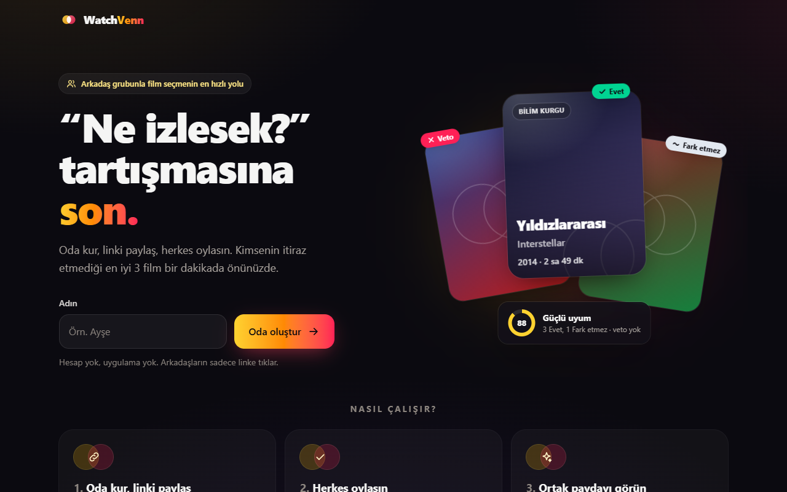
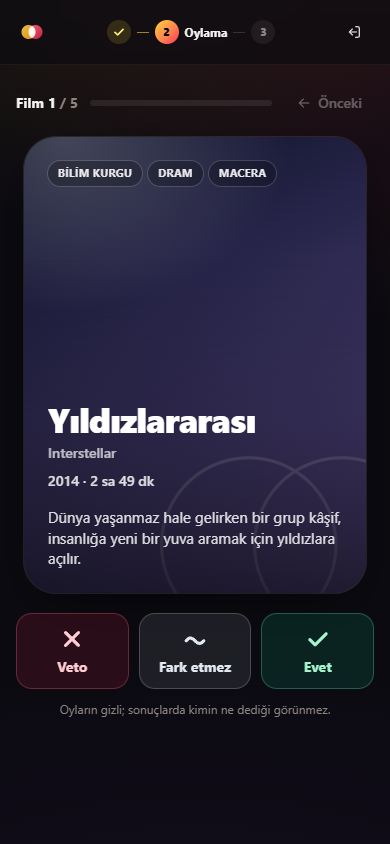
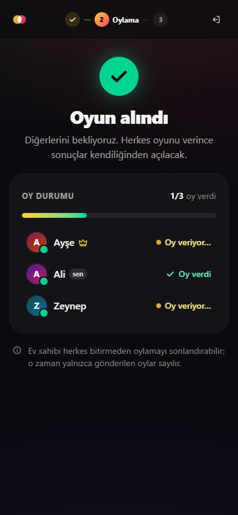
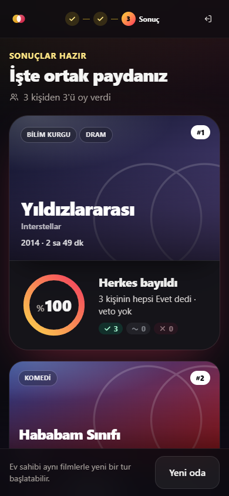
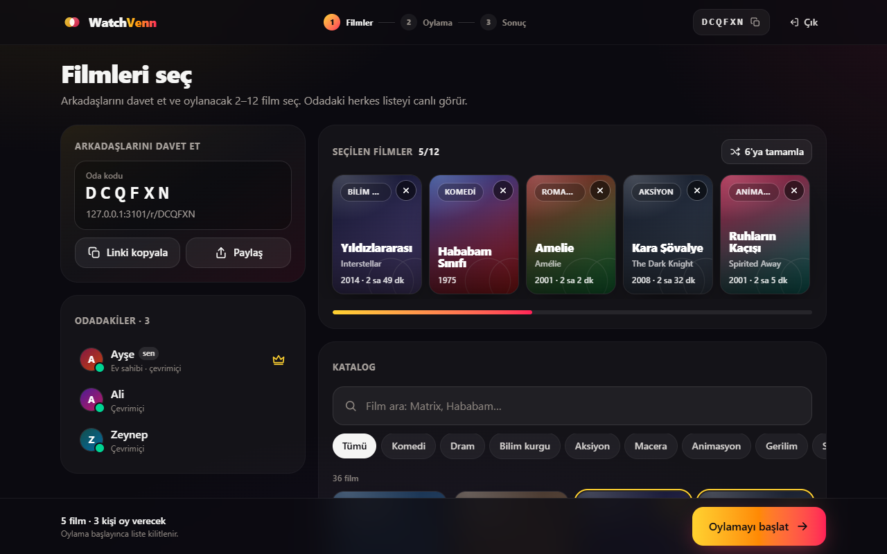
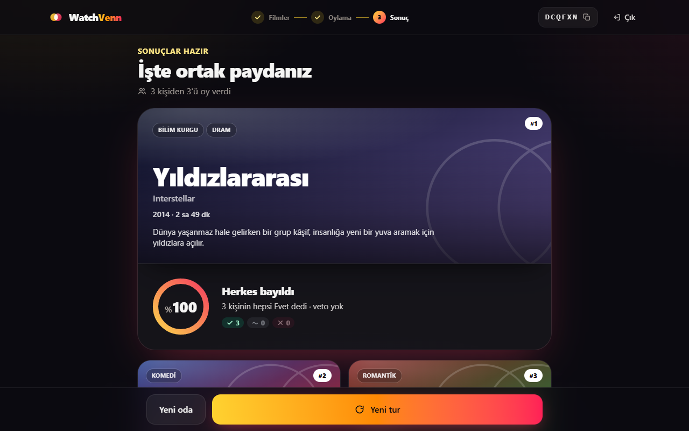

[🇹🇷 Türkçe](README.md) | [🇬🇧 English](README.en.md)

# WatchVenn

**End the "what should we watch?" argument in about a minute.** Someone creates a temporary room and shares the link. Everyone votes *Evet* (yes), *Fark etmez* (don't mind) or *Veto* on a few movies, and the group gets the top three movies nobody objects to, each with a one-line reason. No accounts, no install.

The interface is in Turkish only, for its audience. The code is in English, and this documentation is available in Turkish and English.

> **Live demo:** [https://watchvenn.onrender.com](https://watchvenn.onrender.com)
>
> The demo runs on Render's free tier: after a quiet period, the first visit can take up to about a minute while the service wakes up (see [Deployment](#deployment)).



<table>
  <tr>
    <td align="center"></td>
    <td align="center"></td>
    <td align="center"></td>
  </tr>
  <tr>
    <td align="center"><sub>Vote one card at a time</sub></td>
    <td align="center"><sub>Live "who has voted"</sub></td>
    <td align="center"><sub>Results with the reason</sub></td>
  </tr>
</table>




_Screenshots are from the production build, captured in headless Microsoft Edge at 1280×800 and 390×844._

## Contents

- [Features](#features)
- [The voting algorithm](#the-voting-algorithm-the-venn)
- [Architecture](#architecture)
- [Tech stack](#tech-stack)
- [Getting started](#getting-started)
- [Testing](#testing)
- [Deployment](#deployment)
- [Security notes](#security-notes)
- [Known limitations](#known-limitations)
- [Ideas for later](#ideas-for-later)

## Features

**For the group**
- **Two steps to join:** open the link, type a name. A refresh or a reopened link rejoins as the same person.
- **Live room:** who is in the room and online, the host's movie list filling up, and who has voted, all updated in real time.
- **Fast voting:** one large card at a time, with tap buttons or the ← ↓ → (or 1 2 3) keys, and a review screen where any vote can be changed before submitting once.
- **Votes stay private:** results show counts, never who vetoed what.
- **Results you can explain:** the top three with a compatibility percentage, a label ("Herkes bayıldı", "Güçlü uyum"…), a reason sentence and the full breakdown, including eliminated movies.

**For the host**
- A bundled catalog of 36 movies (international and Turkish classics) with search that ignores accents and Turkish case, plus genre filters, "Rastgele 6 seç" (random six) and free-text custom titles.
- **Start voting:** this locks the voter list. **End early** once at least one ballot is in: only submitted ballots count, and the turnout is shown. **Cancel:** back to the lobby with no results. **New round:** the same list goes back to the lobby.
- **The room never gets stuck:** if the host is offline for 30 s, the role passes automatically to the earliest-joined participant who is still connected.

**Resilience**
- **Reconnects are invisible when quick and clear when not.** A banner appears, controls are disabled, and nothing is sent until the client has rejoined *and* received a fresh room snapshot. Ballot drafts survive refreshes and dropped connections.
- **Every state has a screen:** loading, reconnecting, invalid or expired room, room full, spectating (joined mid-round), waiting for others, no match.

**Polish**
- A dark, cinematic, mobile-first design with gradient movie cards (no images, no external requests).
- Accessible: icon and label on every vote (never color alone), `aria-live` announcements for presence and votes, full keyboard support with visible focus, `prefers-reduced-motion` respected, and hint text and movie-card text checked against WCAG AA contrast.

## The voting algorithm: "the Venn"

Two stages, which is where the name comes from. First, keep the movies everyone can accept (the overlap). Then rank them by enthusiasm.

1. **Overlap:** a movie is eligible only if it has **zero vetoes**. A single veto eliminates it, however many *Evet* votes it got.
2. **Score:** *Evet* = 2 points, *Fark etmez* = 1. `compatibility = round(100 × points / 2V)`, where `V` is the number of submitted ballots. An eligible movie scores between 50% (everyone said *Fark etmez*) and 100% (everyone said *Evet*).
3. **Rank:** by points, highest first. Equal points share a rank ("Berabere") and keep the order the movies were added in, so the output is deterministic. All comparisons use integers, and percentages round half up (87.5 → 88).

In one sentence: *Kimsenin veto etmediği filmler arasında en çok Evet alan kazanır* ("among the movies nobody vetoed, the one with the most yeses wins"). Every eligible movie has only *Evet* and *Fark etmez* votes, so ranking by points is the same as ranking by *Evet* count.

**Worked example, 4 voters:**

| Movie | Evet | Fark etmez | Veto | Result |
|---|---|---|---|---|
| A | 3 | 1 | 0 | 7/8 → **88%**, #1 |
| B | 3 | 0 | 1 | eliminated, despite as many *Evet* as A |
| C | 2 | 2 | 0 | 6/8 → **75%**, #2 |
| D | 0 | 4 | 0 | 4/8 → **50%**, #3 |

**Early end:** if the host ends voting before everyone has voted, every count and percentage is out of the **V people who voted**, never the whole group. The wording changes to match: "Oy veren 3 kişiden 2'si Evet, 1'i Fark etmez dedi · veto yok", and the header always shows the turnout: "5 kişiden 3'ü oy verdi · 2 kişi hesaba katılmadı".

**No match:** if every movie was vetoed, there is no recommendation. The app does not invent a fallback pick. It shows the breakdown and suggests a new round with different movies.

The implementation is one pure function, `computeResults(candidates, ballots, voterCount)` in [`shared/scoring.ts`](shared/scoring.ts), along with the Turkish labels and reason sentences (including the correct possessive suffixes: 4'ü, 2'si, 6'sı…). The server computes the results once and freezes them for that round.

## Architecture

```
Browser (React SPA) ──HTTP──► Express ── serves the built SPA, GET /api/health
        │                        │
        └──── WebSocket ────► Socket.IO handlers ──► rooms.ts (pure rules) ──► Map<code, Room>
                                                          ▲
                                                 sweep(now) every 10 s
```

**One Node process, one URL.** Express serves the built client, and Socket.IO runs on the same HTTP server and origin. That means no CORS, one deploy and one link to share. WebSockets need a long-running process, which rules out serverless.

**The server owns all state and broadcasts full snapshots.** After every accepted change it emits the whole room (`room:state`). Rooms are tiny (at most 12 people and 12 movies), so sending diffs would buy nothing. Snapshots make reconnecting trivial and remove a whole class of client sync bugs.

**Pure rules, thin socket layer.** [`server/rooms.ts`](server/rooms.ts) is the whole state machine as plain functions shaped like `(room, actor, input) → result | error`. Each rule validates before mutating, and time is passed in, so every rule and the cleanup sweep are unit tested without sockets. [`server/socket.ts`](server/socket.ts) only validates the payload, runs the rule, acknowledges and broadcasts.

**The acting participant always comes from the socket, never the payload.** Only a successful create or join sets `socket.data`, so a client cannot act as someone else.

**Identity without accounts.** Joining issues a random 128-bit token (kept in `localStorage`, never broadcast) and a separate public participant id. Rejoining is `room:join { code, token }`.

**Reconnect safety.** [`client/src/lib/roomConnection.ts`](client/src/lib/roomConnection.ts) owns a room's lifecycle outside React. On every (re)connect it rejoins with the stored token. It reports `ready` only once that rejoin is acknowledged *and* a snapshot sent after it has arrived. Replies from an older connection are ignored. Socket.IO's send buffer is cleared on disconnect, because Socket.IO would otherwise replay queued events before the rejoin. As a result, stale actions can never reach the server first.

**No library where a few lines are enough.** A ~30-line `pushState` router, `useSyncExternalStore` instead of a state library, hand-written payload validation instead of zod, CSS keyframes instead of an animation library, and a hand-drawn SVG icon set.

### Room lifecycle

```
 create ──► LOBBY ──start (host, ≥2 movies)──► VOTING ──all voted │ host ends early──► RESULTS
             ▲  ▲                                │                                       │
             │  └───── cancel voting (host) ─────┘                                       │
             └──────────────────────────── new round (host) ─────────────────────────────┘
 Any phase ──(nobody connected for 15 min │ older than 6 h │ 0 participants)──► deleted on the next sweep
```

- People who join after voting starts are **spectators** for that round and vote in the next one.
- A voter who leaves mid-round no longer holds the round up, but still counts in the voter total and is listed as "left".
- In the lobby, someone offline for 60 s is removed. Voters are never removed during voting or results.

### Event contract

Client → server events, each acknowledged with `{ ok: true, … }` or `{ ok: false, error }`. The only server → client event is `room:state` (the full public room). The typed maps live in [`shared/events.ts`](shared/events.ts), so client and server are checked against each other at compile time.

| Event | Payload | Allowed for |
|---|---|---|
| `room:create` | `{ name }` | anyone (max 5 per connection per minute) |
| `room:peek` | `{ code }` | anyone: powers the invite page |
| `room:join` | `{ code, token }` or `{ code, name }` | anyone |
| `room:leave` | — | members |
| `candidates:add` | `{ movieId }` or `{ customTitle }` | host, lobby |
| `candidates:remove` | `{ movieId }` | host, lobby |
| `voting:start` | — | host, lobby, ≥ 2 candidates |
| `vote:submit` | `{ round, ballot }` | locked voters, once per round |
| `voting:end` | — | host, voting, ≥ 1 ballot |
| `voting:cancel` | — | host, voting |
| `round:new` | — | host, results |

Error codes: `ROOM_NOT_FOUND`, `ROOM_FULL`, `SERVER_FULL`, `RATE_LIMITED`, `SESSION_EXPIRED`, `NAME_TAKEN`, `INVALID_INPUT`, `NOT_HOST`, `WRONG_PHASE`, `NOT_A_VOTER`, `ALREADY_VOTED`, `INVALID_BALLOT`, `NO_BALLOTS`, `TOO_FEW_CANDIDATES`, `TOO_MANY_CANDIDATES`, `DUPLICATE_CANDIDATE`. The client maps each one to a Turkish message.

### Limits and timings

All of these are in [`shared/constants.ts`](shared/constants.ts).

| | |
|---|---|
| Participants per room | 12 |
| Candidates per room | 2–12 |
| Rooms per server | 500 |
| Names / custom titles | 1–20 / 1–60 characters, trimmed, control characters removed |
| Largest message | 16 KB |
| Host hand-over | after 30 s offline |
| Lobby removal | after 60 s offline (only while someone else is connected) |
| Room expiry | nobody connected for 15 min, or older than 6 h |
| Heartbeat | 10 s interval + 10 s timeout |

### Project structure

```
client/                 React SPA (Vite)
  src/lib/              socket + request helper, RoomConnection, session storage, router, room event diffing
  src/hooks/            useRoom, useRoomActions, useDocumentTitle
  src/pages/            Home, Room (switches on phase), Invite, RoomNotFound, skeleton
  src/components/       movie cards, catalog picker, vote deck, review, waiting panel, results…
server/
  index.ts              Express + Socket.IO bootstrap, security headers, static files, sweep timer
  socket.ts             handlers: validate → rooms.ts → acknowledge → broadcast
  rooms.ts              in-memory store, state transitions, sweep(), toPublicRoom()
  validation.ts         payload parsing (unknown → typed)
shared/
  types.ts, events.ts   domain types and the typed Socket.IO contract
  constants.ts          limits and timings
  catalog.ts            the bundled movies and gradients
  scoring.ts            computeResults() and the Turkish result text
  text.ts               text cleaning, Turkish-aware comparison keys, room-code parsing
docs/screenshots/       README images
render.yaml             Render Blueprint (one free web service)
```

## Tech stack

- **Client:** React 19, TypeScript, Vite 8, Tailwind CSS 4, socket.io-client
- **Server:** Node.js (≥ 22.12), Express 5, Socket.IO 4
- **Quality:** Vitest, ESLint (typescript-eslint, react-hooks), strict TypeScript (`noUncheckedIndexedAccess`)
- **CI:** GitHub Actions: typecheck, lint, test and build on Node 22.12

Runtime dependencies: `react`, `react-dom`, `express`, `socket.io` and `socket.io-client`. Nothing else.

## Getting started

Requirements: Node.js 22.12 or newer, and npm.

```bash
npm install
npm run dev
```

Open **http://localhost:5173**. Vite serves the client with hot reload, and proxies `/socket.io` (WebSockets included) and `/api` to the Express server on port 3001.

To try a round on your own, create a room, then open the invite link in a **private window**. Tabs in the same browser share one identity, on purpose, so that a refresh keeps you in the room.

### Production build

```bash
npm run build      # client → dist/client, server + shared → dist/server, dist/shared
npm start          # one process on PORT (default 3001)
```

Then open **http://localhost:3001**.

### Scripts

| Script | What it does |
|---|---|
| `npm run dev` | Vite (5173) and the server under `tsx watch` (3001), side by side |
| `npm run build` | Production build of the client and the server |
| `npm start` | Runs the production build |
| `npm test` | All unit and integration tests (Vitest) |
| `npm run typecheck` | `tsc` for the client and the server configurations |
| `npm run lint` | ESLint |

## Testing

`npm test` runs 146 tests in 9 files:

| File | Tests | Covers |
|---|---|---|
| `shared/scoring.test.ts` | 39 | Ranking, veto elimination, ties, no-match, single voter, early end, order independence, rounding, Turkish wording and suffixes |
| `shared/catalog.test.ts` | 9 | Catalog integrity, WCAG AA contrast of white text on every card gradient, deterministic custom gradients |
| `shared/text.test.ts` | 10 | Text cleaning, Turkish case folding, room-code parsing |
| `server/rooms.test.ts` | 47 | Every room rule and the cleanup sweep, with a fake clock |
| `server/validation.test.ts` | 12 | Payload validation for every event |
| `server/socket.test.ts` | 7 | Integration through real socket.io-client connections: a full round with reconnect, early end, new round and cancel, host hand-over, leaving with two tabs, the creation limit, bad input |
| `client/src/lib/roomConnection.test.ts` | 17 | The reconnect state machine against a fake transport: no action before rejoin + snapshot, stale replies ignored, expired sessions, presence release |
| `client/src/lib/roomEvents.test.ts` | 4 | Deriving joins, drops, votes, hand-overs, cancels and early ends from snapshots |
| `client/src/lib/roster.test.ts` | 1 | Voter totals with departed voters |

The UI itself was verified during development by driving the production build in headless Microsoft Edge (over the Chrome DevTools Protocol). That covered every screen at phone and desktop widths, keyboard-only use, reduced motion, offline/online transitions and multi-person rounds. Those scripts are not part of this repository, and there is no automated browser test suite yet.

## Deployment

WatchVenn deploys as **one free Render web service**: one process serves both the site and the WebSockets. [`render.yaml`](render.yaml) describes it:

| Setting | Value |
|---|---|
| Runtime | Node |
| Build command | `npm ci --include=dev && npm run build` |
| Start command | `npm start` |
| Health check path | `/api/health` |
| Instance type | Free |

`--include=dev` makes sure Vite and TypeScript are installed for the build even if `NODE_ENV=production` is set. The server listens on the `PORT` Render provides.

The [live demo](https://watchvenn.onrender.com) is a Render web service that deploys from this repository's `main` branch.

### Deploy steps

1. Push the repository to GitHub (see [Publishing on GitHub](#publishing-on-github)).
2. In the [Render dashboard](https://dashboard.render.com), choose **New → Blueprint** and connect the GitHub repository. Render reads `render.yaml` and proposes one free web service named `watchvenn`. Review it and click **Apply**.
   - Without the Blueprint, choose **New → Web Service**, connect the repository and enter the settings from the table above. Choose the **Free** instance type.
3. Wait for the first build and deploy to finish, then open the `https://<service>.onrender.com` URL. `GET /api/health` should return `{"ok":true}`.
4. Smoke test: create a room, join from a private window and from a phone, and finish a round.

With `autoDeploy: true`, every push to the connected branch redeploys.

### Things to know about the free tier

- **Cold starts:** a free service sleeps after a period without traffic. The first visit after that can take up to about a minute while it wakes up. The home page's "Oda oluştur" button waits up to 45 s for the connection.
- **Rooms live only in memory.** A restart, a redeploy or the service going to sleep deletes every room. Anyone still in a deleted room sees "Bu oda artık yok" and can start a new one.
- **Run exactly one instance.** State is per process, so scaling to several instances would split rooms between them (see [Ideas for later](#ideas-for-later)).

### Publishing on GitHub

This repository is published at [github.com/melihuur1/watchvenn](https://github.com/melihuur1/watchvenn). To publish the code to a new GitHub repository:

```bash
# Create an empty repository on GitHub first (no README, .gitignore or license), then:
git remote add origin https://github.com/<you>/watchvenn.git
git push -u origin main
```

CI ([`.github/workflows/ci.yml`](.github/workflows/ci.yml)) then runs typecheck, lint, tests and build on every push to `main` and on pull requests.

## Security notes

- **Untrusted input:** every payload is parsed from `unknown` with explicit checks: types, lengths, ids, the vote values, and a ballot covering exactly the candidate set. Text is trimmed, NFC-normalized, and control and invisible formatting characters are removed. React escapes all output, and no HTML is ever injected.
- **No impersonation:** the acting participant comes from the server-side socket state. Tokens are 128-bit random values, are never broadcast, and individual ballots are never sent to clients.
- **Bounded resources:** a 16 KB message cap, at most 500 rooms, 12 people and 12 movies per room, and five new rooms per connection per minute. Idle rooms are swept automatically. A handler error is logged and answered rather than crashing the process, and the sweep is guarded the same way.
- **HTTP headers** (no library): a Content Security Policy that allows only this origin's scripts and styles (no inline code), plus `X-Content-Type-Options: nosniff`, `X-Frame-Options: DENY`, `Referrer-Policy: same-origin` and a restrictive `Permissions-Policy`. Socket.IO's bundled client endpoint is disabled.
- **No cookies or authentication**, so there is no session to hijack. A room code is the invitation: anyone with the link can join (up to 12 people).

## Known limitations

- **In-memory, single instance.** Rooms disappear on restart, redeploy or free-tier sleep. Horizontal scaling would need a shared store and sticky sessions.
- **Abuse protection is basic.** Room creation is limited per connection, not per IP address: an attacker opening many connections could still fill the 500-room cap, though only until those rooms expire (15 minutes). Per-IP limits would need trusted proxy headers from the host.
- **The CSP allows `ws:` and `wss:` to any host**, so the WebSocket works the same in every browser. Scripts are still restricted to this origin.
- **Same-browser tabs are one person.** To test alone, use a private window.
- **The catalog is small and bundled** (36 movies). Release years and descriptions are included. Runtimes are shown only where they could be verified, and are left out for 9 of the Turkish films.
- **Browser coverage:** verified in Chromium (Microsoft Edge) at phone and desktop sizes. Not yet tested on Safari, Firefox or physical iOS/Android devices.
- **The UI is Turkish only**, and no license has been chosen yet. Add one before inviting reuse.

## Ideas for later

- TMDB search and posters
- Movie suggestions from participants, not only the host
- A limited "veto budget" per person
- Swipe gestures on the voting deck
- Persistence, or multiple instances with a shared store
- An English UI
