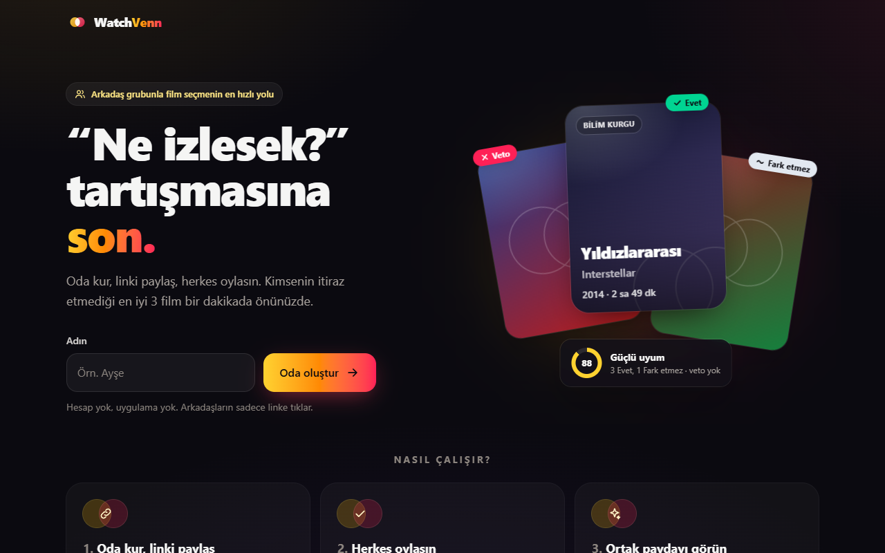
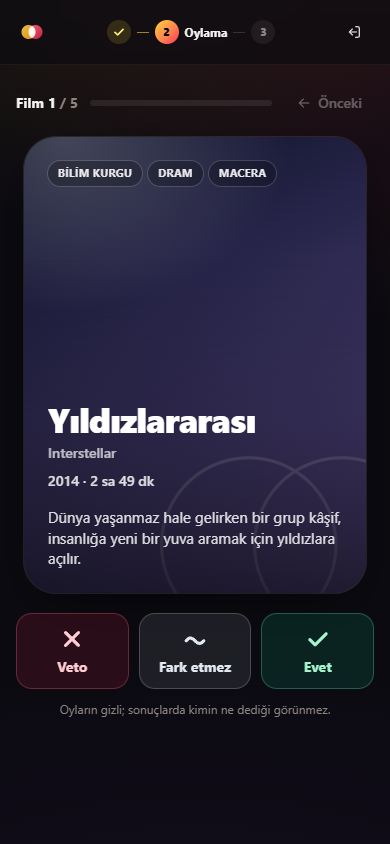
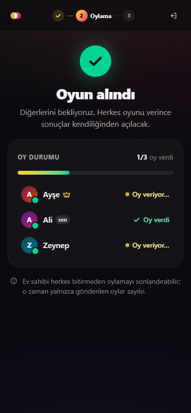
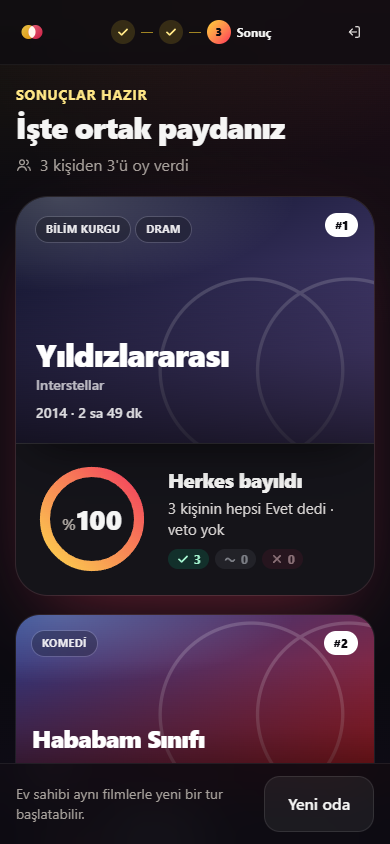
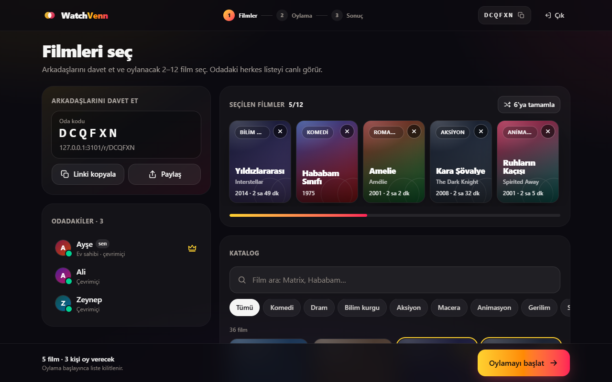
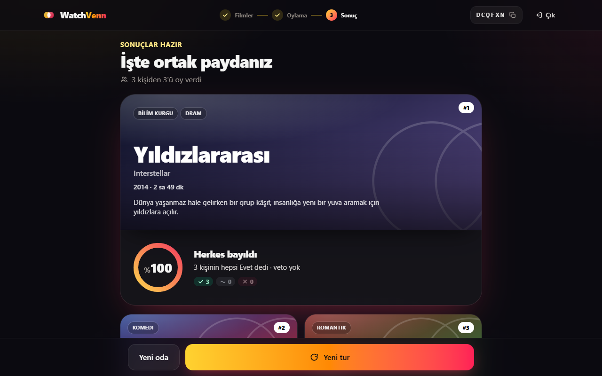

[🇹🇷 Türkçe](README.md) | [🇬🇧 English](README.en.md)

# WatchVenn

**"Ne izlesek?" tartışmasını yaklaşık bir dakikada bitirin.** Biri geçici bir oda oluşturur ve linki paylaşır. Herkes birkaç film için *Evet*, *Fark etmez* ya da *Veto* der; grup da kimsenin itiraz etmediği en iyi üç filmi, her birinin tek cümlelik gerekçesiyle birlikte görür. Hesap yok, kurulum yok.

Arayüz, hedef kitlesine uygun olarak yalnızca Türkçedir. Kod İngilizcedir; belgeler ise Türkçe ve İngilizce olarak sunulur.

> **Canlı demo:** [https://watchvenn.onrender.com](https://watchvenn.onrender.com)
>
> Demo, Render'ın ücretsiz katmanında çalışır: bir süre ziyaret almadıktan sonraki ilk açılışta servisin uyanması bir dakikayı bulabilir (bkz. [Dağıtım](#dağıtım)).



<table>
  <tr>
    <td align="center"></td>
    <td align="center"></td>
    <td align="center"></td>
  </tr>
  <tr>
    <td align="center"><sub>Kartları tek tek oylayın</sub></td>
    <td align="center"><sub>Canlı "kim oy verdi"</sub></td>
    <td align="center"><sub>Gerekçesiyle birlikte sonuçlar</sub></td>
  </tr>
</table>




_Ekran görüntüleri üretim derlemesinden alınmıştır; başsız (headless) Microsoft Edge ile 1280×800 ve 390×844 boyutlarında yakalanmıştır._

## İçindekiler

- [Özellikler](#özellikler)
- [Oylama algoritması](#oylama-algoritması-venn)
- [Mimari](#mimari)
- [Teknoloji yığını](#teknoloji-yığını)
- [Başlarken](#başlarken)
- [Testler](#testler)
- [Dağıtım](#dağıtım)
- [Güvenlik notları](#güvenlik-notları)
- [Bilinen sınırlamalar](#bilinen-sınırlamalar)
- [Gelecek için fikirler](#gelecek-için-fikirler)

## Özellikler

**Grup için**
- **Katılmak iki adım:** linki açın, adınızı yazın. Sayfayı yenilediğinizde ya da linki yeniden açtığınızda odaya aynı kişi olarak dönersiniz.
- **Canlı oda:** odada kimlerin bulunduğu ve kimin çevrimiçi olduğu, ev sahibinin film listesinin dolması ve kimlerin oy verdiği; hepsi gerçek zamanlı güncellenir.
- **Hızlı oylama:** her seferinde tek büyük kart; dokunmatik düğmeler ya da ← ↓ → (veya 1 2 3) tuşları. Ayrıca oylar tek seferde ve kesin olarak gönderilmeden önce her oyun değiştirilebildiği bir gözden geçirme ekranı ("Oylarını gözden geçir") vardır.
- **Oylar gizli kalır:** sonuçlarda yalnızca sayılar görünür; kimin neyi veto ettiği asla gösterilmez.
- **Açıklanabilir sonuçlar:** en iyi üç film; her biri için bir uyum yüzdesi, bir etiket ("Herkes bayıldı", "Güçlü uyum"…), bir gerekçe cümlesi ve elenen filmler dahil tam döküm ("Tüm sonuçlar").

**Ev sahibi için**
- 36 filmlik (uluslararası ve Türk klasikleri) yerleşik bir katalog: aksanları ve Türkçe büyük/küçük harf farkını yok sayan arama, tür filtreleri, "Rastgele 6 seç" ve serbest metinle kendi film adınızı ekleme ("Özel ekleme").
- **Oylamayı başlat:** oy verenlerin listesini kilitler. **Erken bitirme** ("Oylamayı şimdi bitir") en az bir oy geldiğinde mümkündür: yalnızca gönderilmiş oylar sayılır ve katılım gösterilir. **İptal** ("Oylamayı iptal et"): sonuç çıkmadan lobiye dönülür. **Yeni tur:** aynı film listesiyle lobiye dönülür.
- **Oda asla takılı kalmaz:** ev sahibi 30 sn çevrimdışı kalırsa rol, hâlâ bağlı olanlar arasından odaya en erken katılmış kişiye otomatik olarak geçer.

**Dayanıklılık**
- **Yeniden bağlanma hızlıysa fark edilmez, değilse açıkça görünür.** Bir uyarı bandı belirir, kontroller devre dışı kalır ve istemci odaya yeniden katılıp *ve* güncel bir oda anlık görüntüsü (snapshot) alana kadar hiçbir şey gönderilmez. Oy taslakları sayfa yenilemelerinden ve kopan bağlantılardan etkilenmez.
- **Her durumun bir ekranı var:** yükleniyor, yeniden bağlanıyor, geçersiz ya da süresi dolmuş oda, dolu oda, izleyici (tur ortasında katılanlar), diğerlerini bekleme, eşleşme yok.

**Son dokunuşlar**
- Karanlık, sinematik ve önce mobil düşünülmüş bir tasarım; film kartları gradyanlıdır (görsel yok, dış istek yok).
- Erişilebilir: her oyda simge ve etiket (asla yalnızca renk değil), katılımcıların durumu ve oylar için `aria-live` duyuruları, görünür odakla tam klavye desteği, `prefers-reduced-motion` tercihine uyum; ipucu metinleri ve film kartı metinleri WCAG AA kontrast ölçütüne göre denetlendi.

## Oylama algoritması: "Venn"

İki aşamalıdır; adı da buradan gelir. Önce herkesin kabul edebileceği filmler tutulur (kesişim). Sonra bunlar coşkuya göre sıralanır.

1. **Kesişim:** bir film ancak **hiç veto almamışsa** aday kalır. Tek bir veto, film kaç *Evet* almış olursa olsun onu eler.
2. **Puan:** *Evet* = 2 puan, *Fark etmez* = 1 puan. Uyum yüzdesi `compatibility = round(100 × points / 2V)` ile hesaplanır; burada `points` filmin toplam puanı, `V` ise gönderilen oy pusulası sayısıdır. Aday kalan bir filmin uyumu %50 (herkes *Fark etmez* dedi) ile %100 (herkes *Evet* dedi) arasındadır.
3. **Sıralama:** puana göre, en yüksekten başlayarak. Eşit puanlı filmler aynı dereceyi paylaşır ("Berabere") ve listeye eklenme sıralarını korur; böylece çıktı deterministiktir. Tüm karşılaştırmalar tam sayılarla yapılır ve yüzdeler yarım yukarı yuvarlanır (87,5 → 88).

Tek cümleyle: *Kimsenin veto etmediği filmler arasında en çok Evet alan kazanır.* Aday kalan her filmde yalnızca *Evet* ve *Fark etmez* oyları bulunduğundan, puana göre sıralamak *Evet* sayısına göre sıralamakla aynı sonucu verir.

**Örnek (4 kişi oy veriyor):**

| Film | Evet | Fark etmez | Veto | Sonuç |
|---|---|---|---|---|
| A | 3 | 1 | 0 | 7/8 → **%88**, 1. sıra |
| B | 3 | 0 | 1 | A kadar *Evet* almasına rağmen elendi |
| C | 2 | 2 | 0 | 6/8 → **%75**, 2. sıra |
| D | 0 | 4 | 0 | 4/8 → **%50**, 3. sıra |

**Erken bitirme:** ev sahibi herkes oy vermeden oylamayı bitirirse, tüm sayılar ve yüzdeler grubun tamamına göre değil, **oy veren V kişiye** göre hesaplanır. Metinler de buna göre değişir: "Oy veren 3 kişiden 2'si Evet, 1'i Fark etmez dedi · veto yok". Başlıkta ise katılım her zaman gösterilir: "5 kişiden 3'ü oy verdi · 2 kişi hesaba katılmadı".

**Eşleşme yok:** her film veto edildiyse öneri yapılmaz. Uygulama yedek bir seçim uydurmaz; dökümü gösterir ve farklı filmlerle yeni bir tur önerir.

Algoritmanın uygulaması, [`shared/scoring.ts`](shared/scoring.ts) içindeki tek bir saf fonksiyondur: `computeResults(candidates, ballots, voterCount)`. Türkçe etiketler ve gerekçe cümleleri de (doğru iyelik ekleriyle: 4'ü, 2'si, 6'sı…) aynı dosyadadır. Sunucu sonuçları bir kez hesaplar ve o tur için dondurur.

## Mimari

```
Tarayıcı (React SPA) ──HTTP──► Express ── derlenmiş SPA'yı sunar, GET /api/health
        │                         │
        └──── WebSocket ─────► Socket.IO işleyicileri ──► rooms.ts (saf kurallar) ──► Map<code, Room>
                                                               ▲
                                                    her 10 sn'de sweep(now)
```

**Tek Node süreci, tek URL.** Express derlenmiş istemciyi sunar; Socket.IO da aynı HTTP sunucusunda ve aynı kökende (origin) çalışır. Bu sayede CORS gerekmez; tek bir dağıtım ve paylaşılacak tek bir link olur. WebSocket'ler uzun süre çalışan bir süreç gerektirdiğinden sunucusuz (serverless) çözümler seçenek dışıdır.

**Tüm durumu sunucu tutar ve tam anlık görüntüler yayınlar.** Kabul edilen her değişiklikten sonra odanın tamamını gönderir (`room:state`). Odalar çok küçük olduğundan (en fazla 12 kişi ve 12 film) yalnızca farkları (diff) göndermek bir şey kazandırmaz. Anlık görüntüler yeniden bağlanmayı basitleştirir ve istemci senkronizasyonu hatalarının bütün bir sınıfını ortadan kaldırır.

**Saf kurallar, ince soket katmanı.** [`server/rooms.ts`](server/rooms.ts), durum makinesinin tamamını `(room, actor, input) → result | error` biçiminde düz fonksiyonlar olarak içerir. Her kural değişiklik yapmadan önce doğrulama yapar ve zaman dışarıdan parametre olarak verilir; bu sayede her kural ve temizlik taraması (sweep) soket olmadan birim testleriyle sınanır. [`server/socket.ts`](server/socket.ts) yalnızca yükü (payload) doğrular, kuralı çalıştırır, isteği yanıtlar (acknowledge) ve yayın yapar.

**İşlemi yapan katılımcı her zaman yükten değil, soketten gelir.** `socket.data` yalnızca başarılı bir oda oluşturma ya da katılma işlemiyle atanır; dolayısıyla bir istemci başkası adına işlem yapamaz.

**Hesapsız kimlik.** Katılırken rastgele 128 bitlik bir belirteç (token; `localStorage`'da saklanır, asla yayınlanmaz) ve bundan ayrı, herkese açık bir katılımcı kimliği verilir. Yeniden katılmak `room:join { code, token }` ile yapılır.

**Güvenli yeniden bağlanma.** [`client/src/lib/roomConnection.ts`](client/src/lib/roomConnection.ts) bir odanın yaşam döngüsünü React'in dışında yönetir. Her (yeniden) bağlanmada saklanan belirteçle odaya tekrar katılır. Durumu ancak bu yeniden katılma onaylandığında *ve* ondan sonra gönderilmiş bir anlık görüntü geldiğinde `ready` (hazır) olarak bildirir. Eski bir bağlantıdan gelen yanıtlar yok sayılır. Bağlantı koptuğunda Socket.IO'nun gönderim arabelleği temizlenir; aksi hâlde Socket.IO kuyruktaki olayları yeniden katılmadan önce tekrar gönderirdi. Sonuç olarak eskimiş işlemler sunucuya asla önce ulaşamaz.

**Birkaç satırın yettiği yerde kütüphane yok.** ~30 satırlık bir `pushState` yönlendiricisi, durum yönetimi kütüphanesi yerine `useSyncExternalStore`, zod yerine elle yazılmış yük doğrulaması, animasyon kütüphanesi yerine CSS keyframe'leri ve elle çizilmiş bir SVG simge seti.

### Oda yaşam döngüsü

```
 oluştur ──► LOBİ ──başlat (ev sahibi, ≥2 film)──► OYLAMA ──herkes oy verdi │ ev sahibi erken bitirdi──► SONUÇLAR
              ▲ ▲                                    │                                                     │
              │ └── oylamayı iptal et (ev sahibi) ───┘                                                     │
              └─────────────────────────────────── yeni tur (ev sahibi) ───────────────────────────────────┘
 Herhangi bir aşama ──(15 dk boyunca kimse bağlı değil │ 6 saatten eski │ 0 katılımcı)──► sonraki taramada silinir
```

- Oylama başladıktan sonra katılanlar o tur için **izleyici** olur ve bir sonraki turda oy verir.
- Tur ortasında ayrılan bir oy veren artık turu bekletmez; ancak oy veren toplamında sayılmaya devam eder ve "Ayrıldı" olarak listelenir.
- Lobide 60 sn çevrimdışı kalan kişi odadan çıkarılır. Oylama ve sonuç aşamalarında oy verenler asla çıkarılmaz.

### Olay sözleşmesi

İstemciden sunucuya giden olayların her biri `{ ok: true, … }` ya da `{ ok: false, error }` ile yanıtlanır. Sunucudan istemciye giden tek olay `room:state`'tir (odanın herkese açık görünümünün tamamı). Tipli eşlemeler [`shared/events.ts`](shared/events.ts) dosyasındadır; böylece istemci ve sunucu derleme zamanında birbirine karşı denetlenir.

| Olay | Yük | Kimler kullanabilir |
|---|---|---|
| `room:create` | `{ name }` | herkes (bağlantı başına dakikada en fazla 5) |
| `room:peek` | `{ code }` | herkes: davet sayfasını besler |
| `room:join` | `{ code, token }` ya da `{ code, name }` | herkes |
| `room:leave` | — | oda üyeleri |
| `candidates:add` | `{ movieId }` ya da `{ customTitle }` | ev sahibi, lobi |
| `candidates:remove` | `{ movieId }` | ev sahibi, lobi |
| `voting:start` | — | ev sahibi, lobi, ≥ 2 aday |
| `vote:submit` | `{ round, ballot }` | kilitlenen listedeki oy verenler, tur başına bir kez |
| `voting:end` | — | ev sahibi, oylama, ≥ 1 oy pusulası |
| `voting:cancel` | — | ev sahibi, oylama |
| `round:new` | — | ev sahibi, sonuçlar |

Hata kodları: `ROOM_NOT_FOUND`, `ROOM_FULL`, `SERVER_FULL`, `RATE_LIMITED`, `SESSION_EXPIRED`, `NAME_TAKEN`, `INVALID_INPUT`, `NOT_HOST`, `WRONG_PHASE`, `NOT_A_VOTER`, `ALREADY_VOTED`, `INVALID_BALLOT`, `NO_BALLOTS`, `TOO_FEW_CANDIDATES`, `TOO_MANY_CANDIDATES`, `DUPLICATE_CANDIDATE`. İstemci her birini Türkçe bir mesaja eşler.

### Sınırlar ve süreler

Bunların hepsi [`shared/constants.ts`](shared/constants.ts) dosyasındadır.

| | |
|---|---|
| Oda başına katılımcı | 12 |
| Oda başına aday film | 2–12 |
| Sunucu başına oda | 500 |
| İsimler / özel film adları | 1–20 / 1–60 karakter; baştaki ve sondaki boşluklar kırpılır, kontrol karakterleri kaldırılır |
| En büyük mesaj | 16 KB |
| Ev sahipliğinin devri | 30 sn çevrimdışı kaldıktan sonra |
| Lobiden çıkarılma | 60 sn çevrimdışı kaldıktan sonra (yalnızca başka biri bağlıyken) |
| Odanın süresinin dolması | 15 dk boyunca kimse bağlı değilse ya da oda 6 saatten eskiyse |
| Heartbeat (bağlantı yoklaması) | 10 sn aralık + 10 sn zaman aşımı |

### Proje yapısı

```
client/                 React SPA (Vite)
  src/lib/              socket + istek yardımcısı, RoomConnection, oturum depolama, yönlendirici, anlık görüntülerden oda olayları
  src/hooks/            useRoom, useRoomActions, useDocumentTitle
  src/pages/            Home, Room (aşamaya göre değişir), Invite, RoomNotFound, iskelet ekranı
  src/components/       film kartları, katalog seçici, oylama destesi, gözden geçirme, bekleme paneli, sonuçlar…
server/
  index.ts              Express + Socket.IO başlatma, güvenlik başlıkları, statik dosyalar, sweep zamanlayıcısı
  socket.ts             işleyiciler: doğrula → rooms.ts → yanıtla → yayınla
  rooms.ts              bellek içi depo, durum geçişleri, sweep(), toPublicRoom()
  validation.ts         yük ayrıştırma (unknown → tipli)
shared/
  types.ts, events.ts   alan tipleri ve tipli Socket.IO sözleşmesi
  constants.ts          sınırlar ve süreler
  catalog.ts            yerleşik filmler ve gradyanlar
  scoring.ts            computeResults() ve Türkçe sonuç metinleri
  text.ts               metin temizleme, Türkçeye duyarlı karşılaştırma anahtarları, oda kodu ayrıştırma
docs/screenshots/       README görselleri
render.yaml             Render Blueprint (tek ücretsiz web servisi)
```

## Teknoloji yığını

- **İstemci:** React 19, TypeScript, Vite 8, Tailwind CSS 4, socket.io-client
- **Sunucu:** Node.js (≥ 22.12), Express 5, Socket.IO 4
- **Kalite:** Vitest, ESLint (typescript-eslint, react-hooks), katı (strict) TypeScript (`noUncheckedIndexedAccess`)
- **CI:** GitHub Actions: Node 22.12 üzerinde tip denetimi, lint, test ve derleme

Çalışma zamanı bağımlılıkları: `react`, `react-dom`, `express`, `socket.io` ve `socket.io-client`. Başka hiçbir şey yok.

## Başlarken

Gereksinimler: Node.js 22.12 ya da daha yeni bir sürüm ve npm.

```bash
npm install
npm run dev
```

**http://localhost:5173** adresini açın. Vite istemciyi anında yeniden yükleme (hot reload) ile sunar; `/socket.io` (WebSocket'ler dahil) ve `/api` isteklerini 3001 portundaki Express sunucusuna aktarır (proxy).

Bir turu tek başınıza denemek için bir oda oluşturun, ardından davet linkini bir **gizli pencerede** açın. Aynı tarayıcıdaki sekmeler bilinçli olarak tek bir kimliği paylaşır; böylece sayfayı yenilediğinizde odada kalırsınız.

### Üretim derlemesi

```bash
npm run build      # istemci → dist/client, sunucu + shared → dist/server, dist/shared
npm start          # PORT üzerinde tek süreç (varsayılan 3001)
```

Ardından **http://localhost:3001** adresini açın.

### Betikler

| Betik | Ne yapar |
|---|---|
| `npm run dev` | Vite'ı (5173) ve `tsx watch` altındaki sunucuyu (3001) yan yana çalıştırır |
| `npm run build` | İstemcinin ve sunucunun üretim derlemesini oluşturur |
| `npm start` | Üretim derlemesini çalıştırır |
| `npm test` | Tüm birim ve entegrasyon testlerini çalıştırır (Vitest) |
| `npm run typecheck` | İstemci ve sunucu yapılandırmaları için `tsc` çalıştırır |
| `npm run lint` | ESLint |

## Testler

`npm test`, 9 dosyada 146 test çalıştırır:

| Dosya | Test sayısı | Kapsam |
|---|---|---|
| `shared/scoring.test.ts` | 39 | Sıralama, veto ile eleme, beraberlikler, eşleşme olmaması, tek oy veren, erken bitirme, sıradan bağımsızlık, yuvarlama, Türkçe ifadeler ve ekler |
| `shared/catalog.test.ts` | 9 | Katalog bütünlüğü, her kart gradyanı üzerindeki beyaz metnin WCAG AA kontrastı, deterministik özel gradyanlar |
| `shared/text.test.ts` | 10 | Metin temizleme, Türkçe büyük/küçük harf dönüşümü, oda kodu ayrıştırma |
| `server/rooms.test.ts` | 47 | Sahte bir saatle her oda kuralı ve temizlik taraması |
| `server/validation.test.ts` | 12 | Her olay için yük doğrulaması |
| `server/socket.test.ts` | 7 | Gerçek socket.io-client bağlantılarıyla entegrasyon: yeniden bağlanma içeren tam bir tur, erken bitirme, yeni tur ve iptal, ev sahipliğinin devri, iki sekmeyle ayrılma, oda oluşturma sınırı, hatalı girdi |
| `client/src/lib/roomConnection.test.ts` | 17 | Sahte bir aktarım katmanına karşı yeniden bağlanma durum makinesi: yeniden katılma + anlık görüntü gelmeden hiçbir işlem yok, eski yanıtlar yok sayılır, süresi dolmuş oturumlar, bağlantı durdurulduğunda odaya ayrılışın bildirilmesi |
| `client/src/lib/roomEvents.test.ts` | 4 | Katılma, kopma, oy, ev sahipliği devri, iptal ve erken bitirme olaylarının anlık görüntülerden çıkarılması |
| `client/src/lib/roster.test.ts` | 1 | Ayrılan oy verenlerle birlikte oy veren toplamları |

Arayüzün kendisi geliştirme sırasında, üretim derlemesi başsız Microsoft Edge'de (Chrome DevTools Protocol üzerinden) çalıştırılarak doğrulandı. Bu doğrulama telefon ve masaüstü genişliklerinde her ekranı, yalnızca klavyeyle kullanımı, azaltılmış hareketi, çevrimdışı/çevrimiçi geçişleri ve çok kişili turları kapsadı. Bu betikler depoda yer almıyor ve henüz otomatik bir tarayıcı test paketi yok.

## Dağıtım

WatchVenn **tek bir ücretsiz Render web servisi** olarak dağıtılır: tek bir süreç hem siteyi hem de WebSocket'leri sunar. [`render.yaml`](render.yaml) bu servisi tanımlar (ayar adları, Render panelinde göründükleri gibi İngilizce bırakılmıştır):

| Ayar | Değer |
|---|---|
| Runtime | Node |
| Build command | `npm ci --include=dev && npm run build` |
| Start command | `npm start` |
| Health check path | `/api/health` |
| Instance type | Free |

`--include=dev`, `NODE_ENV=production` ayarlı olsa bile derleme için Vite ve TypeScript'in kurulmasını sağlar. Sunucu, Render'ın verdiği `PORT` üzerinde dinler.

[Canlı demo](https://watchvenn.onrender.com), bu deponun `main` dalından dağıtılan bir Render web servisidir.

### Dağıtım adımları

1. Depoyu GitHub'a push edin (bkz. [GitHub'da yayımlama](#githubda-yayımlama)).
2. [Render panelinde](https://dashboard.render.com) **New → Blueprint**'i seçin ve GitHub deposunu bağlayın. Render `render.yaml` dosyasını okur ve `watchvenn` adında tek bir ücretsiz web servisi önerir. Öneriyi inceleyin ve **Apply**'a tıklayın.
   - Blueprint kullanmadan: **New → Web Service**'i seçin, depoyu bağlayın ve yukarıdaki tablodaki ayarları girin. Instance type olarak **Free**'yi seçin.
3. İlk derleme ve dağıtımın bitmesini bekleyin, ardından `https://<service>.onrender.com` adresini açın. `GET /api/health` isteği `{"ok":true}` döndürmelidir.
4. Duman testi (smoke test): bir oda oluşturun, gizli bir pencereden ve bir telefondan katılın, ardından bir turu tamamlayın.

`autoDeploy: true` ayarı sayesinde bağlı dala yapılan her push yeniden dağıtımı tetikler.

### Ücretsiz katman hakkında bilinmesi gerekenler

- **Soğuk başlangıç:** ücretsiz bir servis, bir süre trafik almadığında uyku moduna geçer. Bundan sonraki ilk ziyarette servisin uyanması bir dakikayı bulabilir. Ana sayfadaki "Oda oluştur" düğmesi bağlantı için 45 sn'ye kadar bekler.
- **Odalar yalnızca bellekte yaşar.** Yeniden başlatma, yeniden dağıtım ya da servisin uyku moduna geçmesi tüm odaları siler. Silinmiş bir odada kalan herkes "Bu oda artık yok" ekranını görür ve yeni bir oda başlatabilir.
- **Tam olarak tek bir örnek (instance) çalıştırın.** Durum her süreçte ayrı tutulduğundan birden fazla örneğe ölçeklemek odaları bu örnekler arasında bölerdi (bkz. [Gelecek için fikirler](#gelecek-için-fikirler)).

### GitHub'da yayımlama

Bu depo [github.com/melihuur1/watchvenn](https://github.com/melihuur1/watchvenn) adresinde yayımlanmıştır. Kodu yeni bir GitHub deposunda yayımlamak için:

```bash
# Önce GitHub'da boş bir depo oluşturun (README, .gitignore ya da lisans olmadan), ardından:
git remote add origin https://github.com/<you>/watchvenn.git
git push -u origin main
```

Bundan sonra CI ([`.github/workflows/ci.yml`](.github/workflows/ci.yml)), `main` dalına yapılan her push'ta ve her pull request'te tip denetimi, lint, testler ve derlemeyi çalıştırır.

## Güvenlik notları

- **Güvenilmeyen girdi:** her yük, açık denetimlerle `unknown` tipinden ayrıştırılır: tipler, uzunluklar, kimlikler, oy değerleri ve aday kümesini tam olarak kapsayan bir oy pusulası. Metinler kırpılır ve NFC biçimine normalleştirilir; kontrol karakterleri ve görünmez biçimlendirme karakterleri kaldırılır. React tüm çıktıyı kaçışlar (escape) ve hiçbir zaman HTML enjekte edilmez.
- **Kimliğe bürünme yok:** işlemi yapan katılımcı, sunucu tarafındaki soket durumundan gelir. Belirteçler 128 bitlik rastgele değerlerdir ve asla yayınlanmaz; tek tek oy pusulaları da asla istemcilere gönderilmez.
- **Sınırlı kaynaklar:** 16 KB mesaj sınırı; en fazla 500 oda, oda başına 12 kişi ve 12 film; bağlantı başına dakikada beş yeni oda. Boşta kalan odalar otomatik olarak temizlenir. Bir işleyici hatası süreci çökertmek yerine günlüğe yazılır ve yanıtlanır; temizlik taraması da aynı şekilde korunur.
- **HTTP başlıkları** (kütüphanesiz): yalnızca bu kökenin betiklerine ve stillerine izin veren (satır içi kod olmadan) bir Content Security Policy; ayrıca `X-Content-Type-Options: nosniff`, `X-Frame-Options: DENY`, `Referrer-Policy: same-origin` ve kısıtlayıcı bir `Permissions-Policy`. Socket.IO'nun paketle gelen istemci uç noktası devre dışıdır.
- **Çerez ya da kimlik doğrulama yok**, dolayısıyla ele geçirilecek bir oturum da yok. Oda kodu davetin kendisidir: linke sahip olan herkes katılabilir (en fazla 12 kişi).

## Bilinen sınırlamalar

- **Bellek içi, tek örnek.** Odalar yeniden başlatmada, yeniden dağıtımda ya da ücretsiz katmandaki uyku modunda kaybolur. Yatay ölçekleme için ortak bir depo ve yapışkan oturumlar (sticky sessions) gerekir.
- **Kötüye kullanıma karşı koruma temel düzeydedir.** Oda oluşturma IP adresi başına değil, bağlantı başına sınırlanır: çok sayıda bağlantı açan bir saldırgan 500 odalık sınırı yine de doldurabilir, ancak yalnızca bu odaların süresi dolana kadar (15 dakika). IP başına sınırlar, barındırma sağlayıcısından gelen güvenilir proxy başlıkları gerektirir.
- **CSP, `ws:` ve `wss:` bağlantılarına her ana makine için izin verir**; böylece WebSocket her tarayıcıda aynı şekilde çalışır. Betikler yine de bu kökenle sınırlıdır.
- **Aynı tarayıcıdaki sekmeler tek kişidir.** Tek başınıza test etmek için gizli bir pencere kullanın.
- **Katalog küçüktür ve uygulamayla birlikte gelir** (36 film). Yapım yılları ve açıklamalar mevcuttur. Süreler yalnızca doğrulanabildikleri yerde gösterilir; Türk filmlerinin 9'unda yer almaz.
- **Tarayıcı kapsamı:** telefon ve masaüstü boyutlarında Chromium'da (Microsoft Edge) doğrulandı. Safari, Firefox ya da fiziksel iOS/Android cihazlarda henüz test edilmedi.
- **Arayüz yalnızca Türkçedir** ve henüz bir lisans seçilmedi. Başkalarını kodu yeniden kullanmaya davet etmeden önce bir lisans eklenmelidir.

## Gelecek için fikirler

- TMDB araması ve afişler
- Yalnızca ev sahibinden değil, katılımcılardan da film önerileri
- Kişi başına sınırlı sayıda "veto hakkı"
- Oylama destesinde kaydırma hareketleri
- Kalıcı depolama ya da ortak bir depoyla birden fazla örnek
- İngilizce bir arayüz
